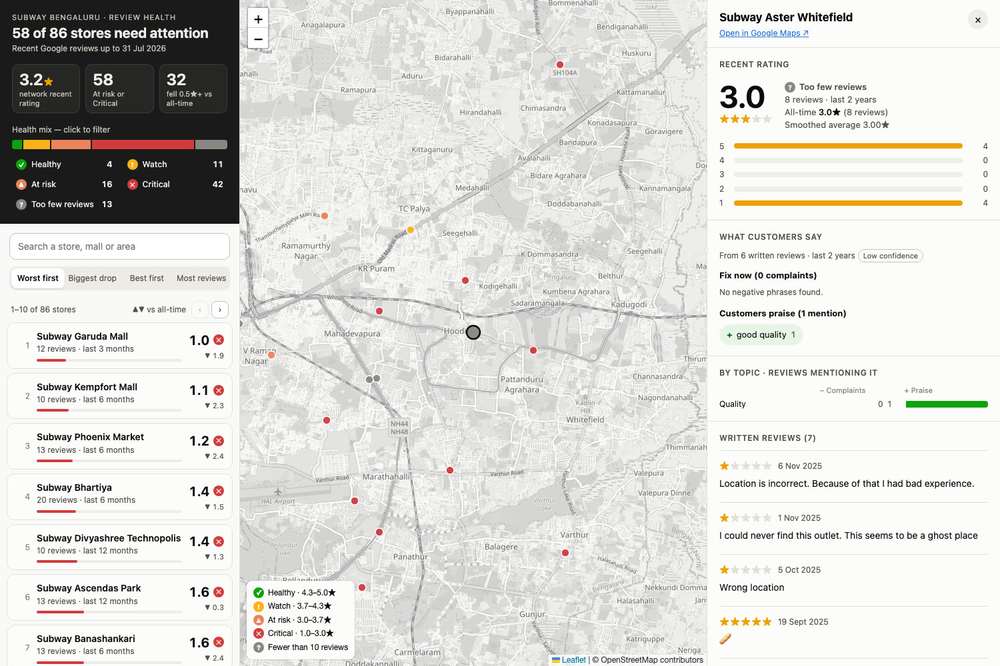

# Store Review Health Check

Turn Google reviews into a health check for every store: its **recent rating**, and **what customers praise or complain about**, in plain phrases like "rude staff" or "stale bread".

**Live demo (86 stores in Bengaluru):** https://store-review-health-deploy.vercel.app/



## What it does

- **Recent rating, not lifetime.** Each store is rated over a window that adapts to how many reviews it has, and the review count and window are always shown ("3.4★ · 13 reviews · last 6 months").
- **Opinion phrases, not keywords.** Review text is parsed with spaCy to extract adjective + topic phrases ("slow service", "not fresh bread"), split into *fix now* and *customers praise*, with counts.
- **Where to look first.** A map of all stores coloured by health tier, a ranked list (worst first, biggest drop, best first, most reviews), search, and filters.
- **Evidence on click.** Each store panel shows the star split, complaints vs praise by topic, and the written reviews behind every phrase.

## How it works

| Step | File | What happens |
| --- | --- | --- |
| 1. Load | `src/load.py` | Read the CSV, parse dates, drop duplicates, cut at `AS_OF_DATE`, assign stable review ids |
| 2. Rating | `src/rating.py` | Pick each store's window and compute raw, smoothed and all-time averages |
| 3. Phrases | `src/phrases.py` | spaCy extraction, topic mapping, negation, sentiment, one count per review |
| 4. Summary | `src/summary.py` | Per-store phrase window and top positive / negative phrases |
| 5. UI data | `src/build_ui.py` | Data files for the map UI (one light file + one detail file per store) |

`run.py` runs all five. Every step prints a short sanity summary.

### Rating

- **Adaptive window:** count back from `AS_OF_DATE`; use 90 days, and widen to 180, 365, then 730 days until the store has at least 10 reviews.
- **Smoothed average:** `(sum of ratings + k × prior) / (n + k)`, with `k = 5` and the store's all-time mean as the prior. Reported alongside the raw average; the UI and health tiers use the raw average so real declines are not softened.
- **Health tiers** on the recent raw average: Healthy ≥ 4.3, Watch ≥ 3.7, At risk ≥ 3.0, Critical below 3.0. Stores with fewer than 10 reviews are shown as "too few reviews".

### Phrases

1. Find adjective–noun pairs: an adjective on a noun ("stale bread") or linked through a verb ("the bread was stale").
2. Handle negation: "not fresh bread" is stored as its own negative phrase.
3. Lemmatise and lowercase.
4. Keep only nouns that map to a fixed topic list (food, bread, veggies, sauce, cheese, protein, taste, quality, portion, price, staff, service, speed, cleanliness, ambience, delivery).
5. Drop generic nouns, non-opinion adjectives and non-words.
6. Sentiment from a small adjective lexicon, falling back to the review's stars (4–5 positive, 1–2 negative).
7. Count each phrase once per review.

Phrases use written reviews of at least two words from the last 365 days; stores with fewer than 15 such reviews fall back to 730 days and are flagged low confidence.

## Getting started

Requires Python 3.10+.

```bash
python3 -m venv .venv
.venv/bin/pip install -r requirements.txt   # includes the spaCy en_core_web_sm model
```

### Input data

The review data is **not in this repo**. Put your own CSV in the project root and point `RAW_CSV` in `config.py` at it. Expected columns:

| Column | Notes |
| --- | --- |
| `store_id` | Unique store key (names are often not unique) |
| `title` | Store name for display |
| `latitude`, `longitude` | Store location |
| `place_id` | Google place id |
| `user_review_date` | Review timestamp (mixed formats are fine) |
| `user_review_date_str` | Same date as `YYYY-MM-DD` |
| `user_review_text` | Review text; may be empty |
| `rating` | 1–5 |

### Run

```bash
.venv/bin/python run.py          # CSV -> outputs/ + ui/data/  (about a minute for ~55k reviews)
.venv/bin/python serve_ui.py     # opens the map at http://localhost:8765
```

The UI must be served (not opened as a file), because the OpenStreetMap tiles are refused to pages opened from disk.

Other useful commands:

```bash
.venv/bin/python -m src.phrases --sample 200   # try phrase extraction on 200 random reviews
.venv/bin/python -m src.build_ui               # rebuild UI data from existing outputs/
.venv/bin/python -m src.deploy                 # build the one-city demo in deploy/
```

## Outputs

| File | One row per | Contents |
| --- | --- | --- |
| `outputs/store_summary.csv` | store | window, review count, raw / smoothed / all-time average, rating label, phrase window, top positive and negative phrases, low-confidence flag |
| `outputs/review_phrases.parquet` | phrase per review | review_id, store_id, aspect, opinion, phrase, polarity |

## Deploying a demo

`src/deploy.py` copies the UI with only the stores inside `DEPLOY_BBOX` (a latitude/longitude box set in `config.py`) into `deploy/`. That folder is plain static files and is the only data committed to git.

On Vercel: import the repo, set **Root Directory** to `deploy`, Framework Preset **Other**, no build command. Each push redeploys.

## Configuration

Every date, threshold and word list lives in `config.py`, including:

| Setting | Default | Meaning |
| --- | --- | --- |
| `AS_OF_DATE` | `2026-07-31` | Ignore reviews after this date (e.g. an incomplete month) |
| `RATING_WINDOW_STEPS` | 90, 180, 365, 730 | Rating windows tried, in days |
| `MIN_REVIEWS_FOR_RATING` | 10 | Reviews needed before a window is accepted |
| `SMOOTHING_K` | 5 | Weight of the prior in the smoothed average |
| `PHRASE_WINDOW_DAYS` | 365 | Phrase window (730 as fallback) |
| `MIN_TEXT_REVIEWS` | 15 | Written reviews needed for the 365-day phrase window |
| `ASPECT_MAP` | 16 topics | Topic → nouns that map to it |
| `UI_RATING_TIERS` | 4.3 / 3.7 / 3.0 | Health tier cut-offs |
| `DEPLOY_BBOX` | Bengaluru | Area included in the deployed demo |

## Known limitations

- Phrase counts per store are small, so the by-topic totals are more reliable than individual phrases.
- About 4 in 10 written reviews yield no phrase: opinions carried by verbs ("love the food"), opinions about named staff, typos, and Hinglish are missed.
- Intensity is flattened by lemmatising ("worst service" becomes "bad service").
- English only.

## Tech stack

Python 3.12 · pandas · spaCy (`en_core_web_sm`) · pyarrow · Leaflet · OpenStreetMap tiles · Vercel (static hosting)
